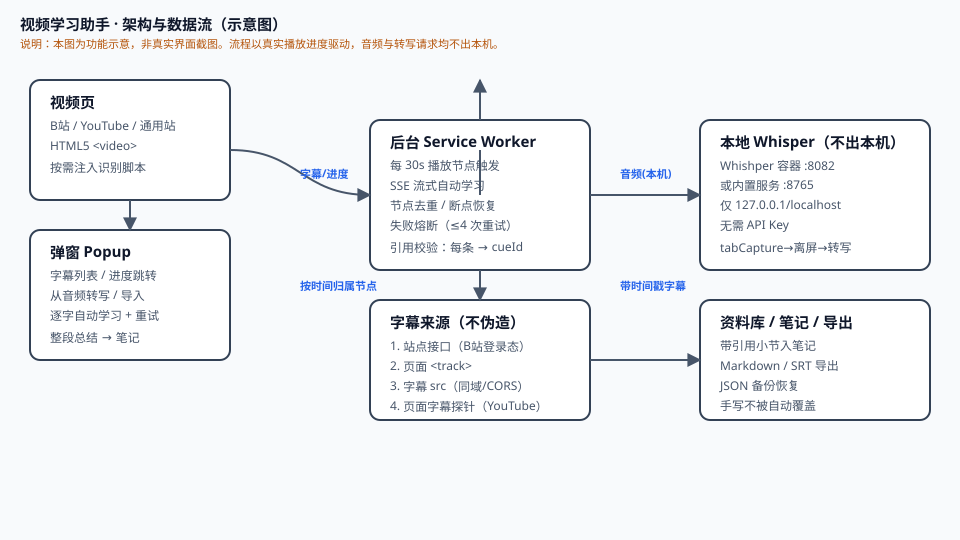

# 视频学习助手

在 B站获取带时间戳的字幕，用**标准弹窗**边听边记、截图视频画面；播放每到达 30 秒节点，后台通过 **SSE 流式自动学习**，正文逐字显示并保存为带引用的小节。

**版本 0.15.0：类型检查、42 个测试文件 / 501 项测试和生产构建通过。已支持通用站点（含 YouTube）与本地 Whisper 转写，新增整段总结、自动重试熔断、弹窗关闭静默取字幕等。真实站点联调（尤其 YouTube 登录态、各模型返回）仍需实际环境验证。**

## 快速开始

```powershell
npm install
npm run compile   # 类型检查
npm test          # 单元与集成测试
npm run build     # 产出 output/chrome-mv3
```

到 `chrome://extensions` 打开开发者模式，加载 `output/chrome-mv3`。升级时只需**重新加载扩展，再刷新视频页**，确认版本 0.8.1；不要为升级而卸载，以免丢失本地资料。

## SSE 自动学习怎么用

1. 在设置中填好 Base URL、支持 SSE 的对话模型和自己的 API Key，授权该模型域名。
2. 勾选 **“允许按播放进度自动发送当前字幕片段到上述服务”**，保存设置。自动请求可能计费，未确认时不会发送。
3. 在 B站普通视频页打开弹窗，获取并载入字幕，或导入 SRT/VTT、从音频转写。
4. 继续播放，切到 **“自动学习”** 页：30 秒处理 0–30 秒，60 秒处理 30–60 秒，末尾不足 30 秒也会处理。无需点“生成总结”。
5. **关闭弹窗仍继续**。重开会接上已保存内容与当前草稿；可用“暂停自动学习”明确停止，或重试失败段。

节点按视频时间追加，不再整片合并重写。向前拖动只处理最新到达区间，不批量补跑跳过内容；回退不重复请求已处理节点。未完整接收或引用校验失败的草稿不会进入正式笔记、导出或备份。

### 遇到“模型返回的不是合法 JSON”

0.8.1 已改为按 JSON 层级和字符串转义识别完整正文，兼容前后说明/代码块、尾逗号、字符串内换行及整体再次编码的 JSON。不会补造缺失内容或引用，也不增加模型重试请求。

升级后可点“重试失败段”。若仍失败，查看错误详情中的 `kind`，并展开 **“查看失败返回（仅本机）”** 检查原始正文；反馈前隐去私密内容，**不要发送 API Key**。纯文本、未闭合 JSON 或多个冲突结果仍会被拒绝，避免假装生成成功。详见验证说明 §9。

## 文档

| 文档 | 内容 |
|---|---|
| [01 · 产品设计文档](docs/01-产品设计文档.md) | 场景、首版范围、页面与异常状态、验收标准 |
| [02 · 技术方案](docs/02-技术方案.md) | 架构、字幕适配、API 接入、AI 校验、数据模型、安全边界 |
| [03 · 开源调研与依据](docs/03-开源调研与依据.md) | 参考项目、固定 commit 证据、许可证核对 |
| [04 · 使用与验证说明](docs/04-使用与验证说明.md) | 新版自动学习（§7.7）、加载步骤、验证结果与边界 |
## 界面示意图

> 下面为**功能示意图（非真实截图）**，用于说明各界面与数据流。真机加载扩展后的实际界面截图将陆续补充到 [`screenshots/`](screenshots/) 目录。



**主流程**

1. **视频页（B站 / YouTube / 通用站点）**：扩展按需注入识别脚本，选定页面 `<video>`，从字幕轨道 / 页面字幕探针 / 本地音频转写获取带时间戳字幕。
2. **弹窗（Popup）**：载入字幕、手动「从音频转写」、查看当前播放进度与自动学习进度；关闭弹窗不中断后台任务。
3. **后台 SW（Service Worker）**：按真实播放进度每 30 秒节点触发 SSE 流式自动学习，逐节点生成带原字幕引用的小节，断点可恢复、失败有熔断。
4. **本地 Whisper（Whishper 容器 / 内置服务）**：仅 `127.0.0.1/localhost`，音频不出本机，无需 API Key。
5. **资料库 / 笔记 / 导出**：带引用的小节入笔记，支持 Markdown、SRT 导出与 JSON 备份恢复。

真实界面元素（以弹窗为例）：字幕列表、播放进度条与跳转、自动学习页（逐字生成 + 失败重试）、整段总结按钮、从音频转写、导入 SRT/VTT。

## 实现范围

- **通用站点**：任意有 HTML5 `<video>` 的 http(s) 页面按需注入识别脚本，按可视面积选定播放器，用 URL 推导稳定身份（`m.`/`music.`/短链归一），播放控制、倍速、音量、截图与本地音频转写都不绑定具体站点。
- **YouTube**：不使用 `<track>`，字幕清单由主世界探针从 `ytInitialPlayerResponse` 读取；`baseUrl` 默认返回 XML timedtext，已统一归一为 WebVTT 后再校验。
- **B站适配器（可选）**：分 P 识别、站方字幕轨道。适配器缺失时自动降级为通用能力，不会整体不可用。
- **本地语音转写（0.10.0）**：采集当前标签页音频 → 本机 Whisper 转文字 → 存成字幕版本。音频不出本机，不使用、也不需要聊天 API Key。
- 站方字幕、SRT/VTT 导入、字幕翻译与时间戳跳转。
- 后台 30 秒节点自动触发、SSE 正文流、弹窗打字机、节点去重、有限中断恢复与失败熔断。
- 旧总结与手写笔记保留；带引用小节、Markdown 笔记自动保存、资料库、Markdown/SRT 导出、JSON 备份恢复。
- 自定义 OpenAI 兼容 API（含 Agnes 预设）、按需域名授权与密钥隔离。

**未实现**：视频画面理解（OCR 读屏）、云同步、商店上架。自动学习基于已保存字幕，不是语音朗读。

## 多站点支持范围与限制

字幕来源按以下顺序尝试，前一条拿不到才走下一条，**任何一条都不会伪造字幕**：

1. 站点接口（仅 B站适配器，需登录态）；
2. 页面 `<track>` 元素（通用，已在浏览器里解析出 cue 时直接转换）；
3. 页面 `<track>` 的 `src` 文本（同源可读；跨域需站点给 CORS 头）；
4. 主世界字幕探针（YouTube 等把字幕放进页面脚本的站点）。

**字幕格式归一**：取回的文本若是 XML timedtext（`<text start dur>` 或 srv3 的 `<p t d>`）或 JSON3，会先转成 WebVTT 再走既有校验。缺时长的条目用下一条真实起点收尾，末条无法推导则丢弃并如实提示，不猜内容。

**浏览器能力限制（无法绕过，只能如实说明）**：

- 第三方域名无 CORS 头的媒体（如 YouTube 的 `googlevideo.com`）会让 canvas 被判为污染 → **截图失败**；DRM 加密内容同理。
- **本地转写改走标签页音频采集**（`tabCapture` + 离屏文档），不再接管网页 `MediaElementSource`，因此不会再让站点播放器静音。代价是必须在该标签页内点击扩展触发（浏览器要求用户手势），且只覆盖当前标签页声音。

**其他限制**：

- 字幕文件只允许读取与当前页面同源的地址（避免把内容脚本当成任意 URL 代理）。
- 通用脚本按需注入，需用户按站点授权；站点改版导致全局对象改名后，探针可能读不到字幕，此时回退到导入 SRT/VTT 或本地转写。
- 转写期间检测到暂停、跳转、静音或非 1 倍速会停止并丢弃当前未校验分片，避免把错误时间轴写进学习记录。

## 本地语音转写怎么用

支持两种本机后端，都是**音频不出本机、不需要 API Key**。设置页「本地语音转写 → 转写服务」切换。

### A. Whishper 容器（推荐，已实测可用）

前提：Docker 中的 `whishper` 容器已运行，主机可访问 `http://127.0.0.1:8082`。

1. 设置页选「Whishper 容器（8082，异步任务）」，地址默认 `http://127.0.0.1:8082`。
2. 模型选 `tiny`（默认）或 `small`，点「测试本地转写」。
3. 视频页点扩展 →「从音频转写」。

**实测速度（纯 CPU，60 秒音频）**：`tiny` 约 **12.6 秒**，`small` 约 **43.6 秒**。
`small` 接近实时，转写跟不上播放时队列会积压并停止（保留已完成部分），因此默认用 `tiny`。

接口细节（适配器已处理，无需手动调用）：`POST /api/transcriptions?modelSize=<m>&language=<l>` 上传后拿任务 id，再 `GET /api/transcriptions/{id}` 轮询；`status` 为 `0` 运行中 / `2` 完成 / `-1` 失败。**缺少 `modelSize`/`language` 参数时 Whishper 会直接失败**，所以适配器强制带上（空语言归一为 `auto`）。

### B. 内置本地服务（8765，同步）

1. 准备完整的 CTranslate2 Whisper 模型目录（含 `model.bin`、`config.json`、`tokenizer.json`）。本仓库**不下载模型**。
2. 启动本机服务：

```powershell
$env:WHISPER_MODEL_DIR = 'D:\models\faster-whisper-small'
.\scripts\start-local-whisper.ps1
```

3. 设置页选「内置本地服务（8765，同步）」，点「测试本地转写」确认 `ready`。

### 使用与验证

- 打开视频页 → 点扩展 → 弹窗内点「从音频转写」；关闭弹窗不影响后台继续，重开可看进度。
- 真实服务集成测试（服务在线才执行，否则自动跳过）：

```powershell
docker cp whishper:/tmp/probe.wav Temp\probe.wav
.\node_modules\.bin\vitest.cmd run tests/whishper-live.test.ts
```

## 关键约束

- 仍使用标准 `panel.html` 弹窗，**不注入悬浮窗、全屏 iframe 或页内样式**。
- 权限为 `storage`、`scripting`、`alarms`、`tabCapture`、`offscreen`。`tabCapture`/`offscreen` 只为「从音频转写」采集当前标签页声音；不申请 `webRequest` 等可读请求内容的权限。
- 字幕元信息请求正常携带站点登录态，但代码不读取 Cookie；模型请求与本地转写请求均 `credentials: omit`、禁止重定向。
- 本地转写只允许 `127.0.0.1` / `localhost`，代码层拒绝云端地址与带鉴权参数的 URL；失败明确报错，不自动回退云端。
- Key 默认存 `storage.session`，可选记住在 `storage.local`，不进入导出、备份或日志。
- 自动学习每条结论必须引用本节点真实 cueId；失败草稿与正式结果分开保存，手写笔记不被自动覆盖。
- 每视频一个流、全局最多两个；连续三个节点失败停止。SW 意外中断最多自动恢复一次；服务端可能已经处理并计费，无法承诺断网时零重复计费。
- 浏览器退出、扩展重载会断开 HTTP；下一次后台唤醒按持久化节点恢复，不是永久保留原连接。暂停视频不启动新节点，已在途请求允许完成。
- 数据库升级只增表，备份继续兼容原结构；备份包含已校验小节，不包含运行队列、草稿与凭据。

- 静音状态只认页面播放器的真实静音操作（`video.muted`）；音量 0、插入/拔出耳机等音频输出设备变化都不算「页面静音」，也不会被当成用户操作结束录音。
- 点「从音频转写」会先自动尝试页面已有字幕（人工/官方优先于自动生成），都没有才实时采集音频；中途暂停只挂起、恢复播放自动续录。
- 采集一启动就把真实播放位置同步给录音器当基线；只有「音频连续 30 秒静音」且「播放位置 15 秒没推进」同时成立才停止采集。

- 打开视频页弹窗即自动尝试视频已有字幕（人工/官方优先），无需手动点按钮；字幕就绪后立即建立自动学习会话，播到 30 秒即流式生成总结。
- 收听区定位为「状态显示 + 进度跳转」：播放/静音受浏览器自动播放策略限制，扩展按钮无法代替，改为明确引导；倍速、音量、进度跳转可直接使用。

版本：0.15.0
