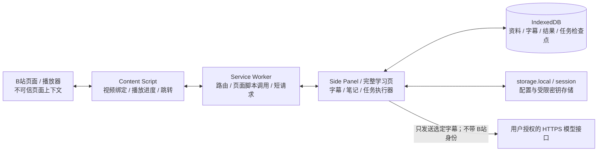

# 视频学习助手｜技术方案

> 版本：v0.1 · 日期：2026-10-19  
> 状态：拟实施方案；当前未编写应用、未用真实 API Key 联调、未实测 B站字幕提取。  
> 阅读顺序：[产品设计文档](01-产品设计文档.md) → 本文 → [开源调研与依据](03-开源调研与依据.md)。  
> 文中的模块、字段、参数预算与目录均为本项目设计，不是对某个开源仓库现有实现的声称。外部技术事实附有来源。

## 1. 推荐架构与取舍

**推荐：Manifest V3 扩展 + WXT / TypeScript / React + IndexedDB + 用户自带的 OpenAI 兼容 API。首版无自建后端。**

| 决策 | 原因 | 暂不采用的方案 |
|---|---|---|
| 浏览器扩展 | 用户已选择；能在正在观看的页面获取播放器上下文 | 独立网页无法直接继承 B站页面访问上下文 |
| 字幕驱动 | 文本可核对、可分段、费用较易控制 | 默认上传整段视频做视觉理解 |
| WXT 工程组织 | 已核实其 MV3 sidepanel 生成逻辑与 Edge 启动配置，见 [R02](03-开源调研与依据.md#r02) | 把大型脚本项目整体搬进扩展 |
| 独立 AI 适配层 | 保留可替换的 Base URL、模型和协议边界 | 根据服务名称在 UI 到处写特殊分支 |
| IndexedDB 存资料 | 字幕、译文、笔记需要结构化记录、索引、事务和版本 | 把全文都放入容量受限的 storage.sync |
| 扩展页面执行 AI 任务 | 便于取消和展示进度，避免依赖常驻 Service Worker | 用心跳强行保活后台执行无限长任务 |
| 本地关键词检索 | 首版目标是找回自己的笔记 | 向量数据库、Embedding、RAG 服务 |
| 独立实现核心逻辑 | 精确匹配产品范围及隐私要求 | 直接 fork 一个需要 Python 后端的完整产品 |

### 1.1 运行位置与信任边界

补充：必要时 SW 通过打包内的 `scripting.executeScript` 函数读取 MAIN world 的播放器信息，或发起有限的页面上下文字幕信息请求。页面返回的数据一律当作不可信输入。**API Key 不进入 Content Script、MAIN world、页面 DOM 或跨页面消息。**

Chrome 官方说明：Content Script 的网络请求仍受页面同源策略约束；获得主机权限的扩展自身页面可发起跨域请求。因此模型调用必须放在扩展可信页面，不能简单塞进 B站网页脚本，见 [D04](03-开源调研与依据.md#d04)。

## 2. 工程和组件划分

### 2.1 建议技术栈

| 层 | 选择 | 备注 |
|---|---|---|
| 构建 | WXT、TypeScript | 实施时锁定稳定版本和 lockfile；调研 commit 不自动等于发布依赖版本 |
| UI | React，轻量组件状态 | 侧边栏与完整学习页共享业务组件，避免首版引入多套状态框架 |
| 本地数据库 | IndexedDB，建议用 Dexie 封装 | 使用仓储接口隔离库，保留 schema 迁移机制 |
| 数据校验 | Zod 或同等运行时 schema | 校验页面消息、字幕文件、模型结果与备份包 |
| Markdown | 本地打包的解析器，禁用原始 HTML，并配合 DOMPurify | 不远程加载 JS；链接另做协议限制 |
| 网络 | 原生 fetch + AbortController | 首版使用非流式 Chat Completions；按批次显示进度 |
| 测试 | Vitest + Playwright + 真实浏览器手动验收 | 纯逻辑、扩展集成、外部服务分层测试 |

目标先为 Windows 上最近稳定版本的 Chrome / Edge。API 设计以 Chrome 116 及以上能力为基线；`sidePanel` 文档标注 Chrome 114+，`sidePanel.open()` 从 116 起且要求用户手势，见 [D03](03-开源调研与依据.md#d03)。实际依赖编译目标和最低版本须在 M0 锁定；Edge 仍需独立验收，不能以“基于 Chromium”代替测试。

### 2.2 拟建模块

| 路径/模块 | 职责 | 不承担 |
|---|---|---|
| `entrypoints/background.ts` | 扩展图标、面板打开、消息路由、短时字幕请求 | 长时间 AI 作业、存放全部运行状态 |
| `entrypoints/bilibili.content.ts` | 页面绑定、视频元素观察、播放时间、跳转执行 | 模型调用、读取密钥 |
| `entrypoints/sidepanel/` | 当前学习流程与本地任务执行器 | 直接依赖 B站 DOM 选择器 |
| `entrypoints/library/` | 资料库、完整学习页、备份恢复 | 自建云同步 |
| `entrypoints/options/` | 模型、语言、权限、密钥策略 | 自动把 Key 同步到浏览器云端 |
| `src/adapters/bilibili/` | 元信息、字幕轨道、字幕正文、平台错误转换 | UI 编辑和 AI Prompt |
| `src/domain/transcript/` | SRT/VTT 解析、统一时间轴、ID、批次划分 | 猜测缺失字幕内容 |
| `src/ai/` | Provider 配置、请求、提示词、结果校验、错误分类 | 任意网页发来的通用 URL 代理 |
| `src/jobs/` | 分段队列、检查点、取消、恢复、去重 | 承诺提供商请求绝对只计费一次 |
| `src/storage/` | 仓储、事务、迁移、冲突与备份 | 隐式覆盖用户编辑 |
| `src/export/` | Markdown/SRT/JSON 导出、文件名和 URL 清理 | 未经用户授权写入本地目录 |

实现时组件只调用领域服务，平台 DOM、模型协议、本地数据库分别隔离，以便其中一项失效时仍可使用其余功能。

## 3. B站视频与字幕适配

### 3.1 首版支持范围

只支持用户当前可访问的 B站普通 `/video/` 页面及其分 P。暂不覆盖番剧、直播、付费课程专用页面、短链接解析和整套收藏夹抓取。

采用 `bilibili:{bvid}:{cid}` 作为资料身份；`bvid` 不能单独代表当前分 P。`pageIndex` 用于显示和构建回看链接，不作为唯一主键。AID/CID 按字符串保存，避免不必要的数值精度假设。

### 3.2 获取顺序

1. 校验当前标签页 URL 属于允许的 B站域名与路径。
2. Content Script 等待可用播放器；通过受限的 MAIN world 调用读取已加载元信息，只返回白名单字段。
3. 记录 `tabId + documentId/页面实例标识 + navigationEpoch + bvid + cid` 的绑定快照。
4. 获取字幕轨道信息；优先复用可读取的页面/播放器数据，必要时使用独立适配器发起字幕信息请求。
5. 用户选定轨道后读取字幕 JSON，转换为统一 Cue 结构。
6. 返回前再次检查页面绑定；旧页面的迟到结果不能写入新视频的当前视图。
7. 成功后生成不可变字幕版本。失败时进入明确错误状态，仍允许导入字幕文件。

Bilibili-Evolved 的固定版本在 `getSubtitleList` 中调用 `/x/player/wbi/v2`，然后从 `subtitle.subtitles` 中选择轨道并读取 `json.body`；yt-dlp 的独立实现也使用该字幕信息链路，并检查 `need_login_subtitle`。见 [R03](03-开源调研与依据.md#r03)、[R05](03-开源调研与依据.md#r05)。这些是**实现依据**，不是接口当前在本环境可用的实测证明，也不是官方开放 API 授权。

### 3.3 登录、跨域与权限

- 需要登录时，由用户在 B站网页自行登录。扩展不读取、导出或上传 `SESSDATA` 等 Cookie。
- 元信息请求若需要页面访问上下文，限定为打包内代码、固定域名/路径和经校验的标识参数；是否可受该页面 CORS/CSP 策略允许，必须在 M0 实测。
- 不以 Content Script 的主机权限能绕过 CORS 为前提，不默认安装跨域代理。
- 字幕正文 CDN 请求只接受 HTTPS、经审核的字幕主机和允许路径；主机匹配按 URL 解析后的 hostname 边界判断，不用字符串 contains。
- 初始权限候选为 B站页面、API 和字幕 CDN 范围；最终 CDN 清单根据真实样本确定。遇到未知主机提示“不支持的字幕来源”，不得升级为任意 URL 访问。
- 字幕临时 URL 只作获取依据；Token/签名参数不进入日志、Markdown 或备份，重试时重新取得轨道地址。
- 不自动修改认证/风控流程，不规避付费、登录或内容访问限制。

### 3.4 统一字幕结构与校验

每条 Cue 至少有：`cueId`、`sequence`、`startMs`、`endMs`、`text`。B站 `body[].from/to/content` 对应起止秒数与正文，转换成整数毫秒；这一原始格式可在 yt-dlp 的 `json2srt` 实现核对，见 [R05](03-开源调研与依据.md#r05)。

| 规则 | 处理 |
|---|---|
| 时间非有限数、负值、终点早于/等于起点 | 视为无效条目，返回诊断；不悄悄丢弃后称全文成功 |
| 正常重叠字幕 | 保留；重叠本身不是错误 |
| 排序异常 | 保留原顺序字段，按时间稳定排序展示并提示修正 |
| 相同文本重复出现 | 默认保留，不用全局去重删除讲者重复强调 |
| HTML/字幕样式标签 | 按支持范围转换为纯文本；不执行 HTML |
| 来源类型无法判断 | 标为 unknown；不根据轨道名称猜成“人工字幕” |
| 超出 2 小时、20,000 Cue 或导入文件超过 5 MiB | 明确限制，建议分段；不静默截断 |

SRT/VTT 解析需支持 BOM、CRLF/LF、多行正文、小时可选的 VTT 时间格式、VTT cue 标识和设置。`NOTE/STYLE/REGION` 属于控制块，按规范跳过并记录处理结果，不能把它们当成讲述内容。首版只保证 UTF-8；解码失败提示转码，不猜测后继续生成。

### 3.5 跳转与站内导航

当前标签页跳转优先用受控的 `video.currentTime`/播放器适配方法，限定时间为有限数且在可用时长内。跳转前重新确认 BV/CID；资料库回看其他视频时先打开规范链接，等待目标分 P 就绪再定位。

导出的回看链接由应用使用受信视频标识和原时间轴生成，拟采用 B站 `p`、`t` 参数并在 M0 验证。不能使用模型返回的任意链接。视频无法访问时仍保留原文引用和时间文本。

## 4. 自接 API 与 Agnes 预设

### 4.1 已核实配置与尚未验证项

Agnes 官方 Overview 和模型文档公开了以下内容，见 [D01](03-开源调研与依据.md#d01)：

| 配置 | 值/结论 |
|---|---|
| 协议起点 | OpenAI 风格 Chat Completions |
| Base URL | `https://apihub.agnes-ai.com/v1` |
| 完整请求地址 | `POST https://apihub.agnes-ai.com/v1/chat/completions` |
| 鉴权 | `Authorization: Bearer <用户自己的 API Key>` |
| 内容类型 | `Content-Type: application/json` |
| 示例模型 | `agnes-2.5-flash`；实际账户是否可用仍需测试 |
| 主要请求字段 | `model`、`messages`；文档还列出 `temperature`、`max_tokens`、`stream` 等可选字段 |
| 文本响应 | `choices[].message.content`，示例包含 `finish_reason` 和 `usage` |
| 未据本次阅读确认 | `/models` 的可用性、严格 JSON Schema 输出、ASR 接口及当前账户配额 |

访问 APIHub 首页时观察到跳转至 Agnes 平台登录流程；这不否定其 API 地址。**网页控制台 URL 与 API Base URL 必须分开。**本次未登录、未获得密钥、未发出带鉴权的生成请求。

### 4.2 ProviderProfile 设计

| 字段 | 用途 |
|---|---|
| `id / name` | 用户给服务配置的标识与名称 |
| `protocol` | 首版固定为 `openai-chat-completions`；其他协议未来通过适配器加入 |
| `baseUrl` | 含版本/代理路径的 API 基地址，保留用户指定路径前缀 |
| `modelId` | 精确模型名称，不由 UI 擅自纠正 |
| `keyRef / keyPersistence` | 引用独立密钥记录；session 或用户明确选择的 local |
| `capabilities` | 可选参数、流式、结构化输出、输出预算等能力；未验证项保持 unknown/disabled |
| `requestLimits` | 超时、每段预算、并发与重试上限，均有应用级默认值 |
| `pricingSnapshot` | 可选的单价、币种、核对时间，不将宣传价写死为永久价格 |

通用适配接口划分为：配置校验、目标地址构建、连接测试、完成请求、响应解析、错误转换。首版只实现一个明确的兼容协议，不宣称“填写任意 URL 即支持所有模型”。Obsidian Clipper 的 Provider 分层可参考，但其通用 `baseUrl` 实际被直接当完整 endpoint 使用；本项目采用的“基地址 + endpoint”规则不同，见 [R01](03-开源调研与依据.md#r01)。

### 4.3 URL 与权限规则

1. 首版只接受 HTTPS；拒绝 URL 中的账号密码、query、fragment、非 HTTP 协议和空 hostname。localhost HTTP 支持后置。
2. Base URL 去尾部斜线，再追加 `/chat/completions`，不能再无条件添加 `/v1`。
3. 若粘贴的是完整 `/chat/completions` 地址，提示用户转换为基地址并确认；避免重复路径。
4. 表单展示最终请求 URL 和目标域名。用户修改域名后须重新授权、重新确认发送目的地。
5. 为支持运行时自定义域名，Manifest 可声明 `optional_host_permissions: ["https://*/*"]`，但每次只申请当前模型主机权限。此机制及用户手势要求见 [D05](03-开源调研与依据.md#d05)。这不等于安装时获取所有网站权限。
6. 真正发送前校验 URL 与用户确认的 origin/path 一致；`credentials: omit`，拒绝自动重定向。不得把 Authorization 带到未经确认的跳转目标。
7. 权限被撤销时中断新请求并保留结果；移除服务配置时按共享使用情况撤销不再需要的可选权限。

### 4.4 密钥策略

- 默认使用 `chrome.storage.session`，仅可信扩展上下文可见。官方文档说明它在扩展重新加载、更新、禁用和浏览器重启后清空，见 [D06](03-开源调研与依据.md#d06)。这些场景应提示重新填写 Key。
- 可选“在此浏览器记住”：放独立的 `storage.local` 密钥记录，设置访问级别为可信上下文，和可导出资料分开。
- 不使用 `storage.sync` 保存 Key，不写入日志、备份、Prompt、任务配置快照、剪贴板自动内容或 URL。
- 本地持久化不是操作系统安全密钥库，也不能防御已被控制的浏览器/本机。没有主密码等完整设计前，不声称“加密保存绝对安全”。
- Key 由用户输入，不把开发者公共 Key 打包进扩展。连接测试不要求用户把 Key 交给开发者。

### 4.5 请求、校验与错误

首版以 `stream: false` 请求结构化任务，保持结果校验简单；Agnes 文档中的流式支持不是本项目首版必须启用的功能。`temperature/max_tokens` 等可选字段按适配器能力发送；不默认附加未确认支持的 `response_format`、工具调用或联网工具参数。

连接测试使用不含字幕的短文本，请求前告知可能消耗额度。检查 HTTP 成功之外，还须确认返回合法 JSON、包含非空文本，并识别异常终止；如果模型只返回推理而无正文，提示调整模型/参数，不能伪造成功结果。

| 失败类型 | 处理策略 |
|---|---|
| 400 / 不支持参数 | 提示字段/协议问题，不盲目重复相同请求 |
| 401 / 403 | 提示 Key、权限或模型访问问题；不自动重试 |
| 402 | 提示余额、套餐或账户准入问题；保留本地任务 |
| 404 | 分辨 endpoint / model 配置；不自动猜测其他域名 |
| 413 / 上下文超限 / 输出被截断 | 拆小本段或调整预算；不把截断 JSON 作为完成结果 |
| 429 | 优先遵守有效 Retry-After；等待过长则暂停，由用户继续；不提前重试 |
| 临时 5xx | 在用户知悉可能重复计费的前提下，有限退避重试，默认最多两次 |
| 网络断开/超时且服务端处理状态不明 | 标记请求结果未知，提供手动重试；不承诺未计费 |
| 返回 HTML、空响应、非法 JSON/引用 | 标记响应格式错误；该批不进入已完成状态 |
| 用户取消 | AbortController 停止等待与后续调度；不宣称服务端必然停止计费 |

应用级每请求超时初值建议 120 秒，字幕短请求建议 20 秒，实施时用样本调优。重试默认退避加抖动，计入总次数与用量，不以多 Key 轮换规避限流。Agnes 关于 401/402/429 等含义的公开资料见 [D02](03-开源调研与依据.md#d02)。

## 5. 翻译、总结与引用算法

### 5.1 不可变输入

保留原始 Cue 和时间轴，阅读段落/AI 批次都是派生视图。对规范化原字幕计算 `sourceHash`，新抓取内容发生变化则创建新 revision，不覆盖旧引用。

摘要默认读取原文并直接输出目标语言。全文翻译属于独立任务，避免所有总结都先经历翻译、再总结造成额外费用及误差。

### 5.2 分段与预算

- 按完整 Cue 和句子边界分段，带少量相邻上下文；上下文条目标记为 context，不重复要求翻译。
- 以模型上下文和输出预算为上限：输入 + 提示词 + 预计输出须低于安全预算；已知 tokenizer 时使用对应计数，否则明确采用估算并保留余量。
- 开发初值可从每批不超过 60 Cue、约 3,000 字符开始，但这是应用预算，不是模型限制；实际仍受输出和上下文预算约束。
- 出现上下文超限或 `finish_reason` 表示截断时，进一步拆分当前批次。不得仅增加重试次数而继续发送同样超限的文本。
- 单条 Cue 过长时可按文本子段生成内部 ID，结果完整后按原 Cue 合并；不为子段编造新时间戳。

VideoLingo 对相邻块附带前后文，并检查原译文拆分数量一致，值得借鉴；其 Python 文件处理及后续音视频管线不作为浏览器依赖，见 [R04](03-开源调研与依据.md#r04)。

### 5.3 翻译返回契约

返回每个目标 Cue 的 `cueId + translatedText`，不要求模型回传或修改时间戳。验收规则：

1. 所有请求目标 ID 恰好出现一次。
2. 没有未知 ID、重复 ID、缺失 ID 或不合类型的文本。
3. 返回顺序不重要，应用按原 Cue 顺序重排。
4. 校验失败只重试本批；最多追加一次格式修正请求，仍失败则提示人工处理。
5. 译文结果与原文分表/分记录保存，已完成项不被未完成任务清空。

格式正确不代表翻译质量合格，仍用人工抽样检查术语、数字、否定句和代码。

### 5.4 总结采用分层归纳

- Map 阶段只从本批内容生成条目，携带真实 Cue ID。
- Reduce 阶段归并重复观点、组织顺序并保留引用集合；不把所有长视频原文重新塞入一次请求。
- 每一级都验证引用 ID 存在，且来自这一级可见的输入范围；模型自行编造的 ID 使该批校验失败。
- 内容概览、章节、知识点、术语说明、复习答案都携带引用；有意义的陈述无依据时不展示为已验证结论。
- 起止时间由应用解析引用 Cue 得出。UI 同时提供“查看原文”和“回看视频”；不能将一个跨度很长的引用伪装成精确短片段。
- 记录处理覆盖范围。只有所有计划批次处理并完成最终校验后才标记全文完成；允许导出部分结果，但必须显著标注未覆盖范围。
- Prompt 将字幕定义为待分析数据，不执行字幕中的指令；模型不持有工具、密钥或选择请求目标的能力。

### 5.5 缓存与版本

缓存键包括：`videoId + transcriptId + sourceHash + 任务类型 + 选段范围 + targetLanguage + providerId/normalizedEndpoint + modelId + promptVersion + 参数指纹`。相同视频抓取到相同字幕时可复用已有 revision；不跨视频或字幕版本复用带引用的结果。未来加入术语表时也纳入其版本/哈希。Key 本身不进入缓存键和可导出配置。

Prompt、模型、源字幕或输出语言变化时创建新结果，不悄悄复用旧结果。缓存命中仍允许用户明确“重新生成”，但新的 AI 结果不会替换手写笔记。

## 6. 长任务与 Manifest V3 生命周期

Chrome 官方文档列出 Service Worker 的闲置、长请求及 fetch 响应时限，并要求状态持久化，见 [D07](03-开源调研与依据.md#d07)。因此本方案**不依赖 Service Worker 托管整个长视频翻译**。

### 6.1 执行策略

- AI 执行器位于当前打开的扩展学习页面；侧边栏与完整学习页共享代码。
- 建议首版同一 Provider 全局并发为 1。使用扩展同源的 Web Locks 协调多个窗口，数据库记录任务拥有者和尝试编号；浏览器能力在 M0 验证。
- 每次网络响应通过校验后，将结果与 chunk 完成状态放在同一 IndexedDB 事务中提交，再推进下一块。
- 页面关闭、被丢弃或浏览器退出后，无法保证当前请求完成，也不继续排新请求。再次打开时把没有有效执行者的 running 状态转为 interrupted。
- 恢复前重新检查 Key、权限、输入版本和已提交结果；只调度未完成块。
- 切换视频不改变任务输入快照；切换视图与任务归属分开管理。

### 6.2 状态与并发写入

任务主状态：`queued → running → completed`；分支有 `paused / partial / interrupted / cancelled / failed`。错误码和可恢复性是独立字段。

每块保存 `chunkKey、attemptId、status、inputHash、resultRef、usage、errorCode`。回写必须核对当前 attempt 和任务 generation；已取消任务的迟到结果不能自动写成 completed。数据库唯一键防止重复提交，同一来源的多窗口笔记采用 revision 检查并保留冲突副本。

这只能保证本地结果不重复提交，不能保证远程 POST “恰好执行一次”。服务商已处理但客户端未收到时，重试可能重复计费，UI 必须说明。

## 7. 数据模型、保存和迁移

### 7.1 存储分工

| 存储 | 内容 | 安全/容量规则 |
|---|---|---|
| IndexedDB | 视频资料、字幕版本、Cue、译文、摘要、笔记、任务与检查点 | 分表与索引；按需读取正文；处理配额失败 |
| storage.local | 非敏感偏好、Provider 配置；可选独立密钥记录 | 可信上下文；密钥永不参加导出 |
| storage.session | 默认会话 Key、短时运行配置 | 扩展更新/重载/浏览器重启会清空 |
| storage.sync | 首版不用 | 不同步笔记、字幕和密钥 |
| 用户主动导出的文件 | Markdown、SRT、无密钥 JSON 备份 | 不自动写入任意本地路径 |

官方文档说明 storage.local 默认约 10 MB、storage.sync 约 100 KB；这里的 IndexedDB 不受同一个 storage.local 额度约束，但也不是无限磁盘空间，见 [D06](03-开源调研与依据.md#d06)。首版不预先申请 unlimitedStorage；显示可用的存储估计并捕获写入失败，不能通过自动删除手写资料腾空间。

### 7.2 核心实体（设计字段）

| 实体 | 主要字段 | 约束/索引 |
|---|---|---|
| VideoRecord | id、platform、bvid、aid、cid、pageIndex、title、canonicalUrl、durationMs、tags、createdAt、updatedAt | `platform+bvid+cid` 唯一；updatedAt 索引 |
| TranscriptRevision | id、videoId、language、sourceKind、generationKind、trackId、sourceHash、createdAt | sourceKind 为 native/srt/vtt；generationKind 为 human/ai/unknown |
| Cue | transcriptId、cueId、sequence、startMs、endMs、text、sourceIndex | `transcriptId+cueId` 唯一；时间/序号索引 |
| Translation | id、transcriptId、cueId、targetLanguage、cacheKey、text、status | 原文与译文分离；按缓存和 Cue 定位 |
| SummaryArtifact | id、videoId、transcriptId、jobId、language、overview、chapters、keyPoints、terms、reviewQuestions、coverage、providerSnapshot、promptVersion | 各内容条目包含 sourceCueIds；snapshot 无 Key |
| Note | id、videoId、markdown、references、revision、updatedAt | 编辑使用乐观并发版本检查；引用保留来源快照 |
| Job | id、type、videoId、transcriptId、inputHash、configSnapshot（无 Key）、chunkPlan、configFingerprint、state、generation、ownerId、createdAt、updatedAt | 输入与非密钥配置快照不可变；保存分块计划以便恢复；重启恢复不信任旧 tabId |
| ChunkResult | jobId、chunkKey、attemptId、status、result、usage、errorCode | 结果与完成状态原子提交 |

时间轴以整数毫秒保存，生成/更新时间统一 ISO 8601 UTC，UI 再本地化。旧字幕 revision 仍被笔记引用时不自动清理；删除整份资料需要用户确认级联范围。

### 7.3 自动保存、检索与备份

- 编辑器防抖约 800 ms 提交；仅在事务完成后切换为“已保存”。离开页面时尽力 flush，不能把 unload 事件当作可靠持久化保证。
- 读写失败保留编辑器文本并显示“未保存”，允许复制/导出；模型结果写入失败时不继续发下一段付费请求。
- 资料库使用轻量元数据索引和归一化标题/标签/笔记搜索；字幕正文按资料加载，避免启动时读取全部长文本。首版不承诺全库全文秒级语义检索。
- 备份包含 schemaVersion、导出时间、实体与关联引用；由白名单序列化器构造，不能把整个 storage 对象 dump 出去。
- 导入先检查大小、schema、ID、关联关系和冲突，预览后提交。大包分批 staging，最终合并失败可回滚，不先清空当前库。
- 相同 ID、相同内容去重；相同 ID、不同内容默认保留冲突副本；不能按更新时间直接覆盖双方编辑。
- 数据库迁移使用版本化事务；不支持的高版本备份拒绝并解释。升级前涉及破坏性变更时先提供备份，其他窗口收到 versionchange 后提示关闭连接。

### 7.4 导出

Markdown 由结构化数据生成，不从渲染 DOM 抓取 HTML。可参考 Clipper 将属性 frontmatter 与编辑内容组合后导出 Markdown 的方式，见 [R01](03-开源调研与依据.md#r01)。

所有文件名移除路径分隔符、控制字符和不适用字符，限制长度；YAML/frontmatter 字符串正确转义。来源链接由应用构造并移除跟踪/认证参数。原文和模型输出按数据处理，预览禁用脚本、内联事件、危险协议及自动外部资源加载。JSON 备份与 Markdown 导出分别测试密钥排除规则。

## 8. 消息协议、权限和安全边界

### 8.1 消息契约

| 消息 | 允许方向 | 校验重点 |
|---|---|---|
| CAPTURE_VIDEO / LIST_TRACKS | 可信 UI → SW → 目标标签页 | 标签页仍属允许域名、当前页面实例、参数白名单 |
| VIDEO_CONTEXT_CHANGED | Content → SW → UI | sender.tab、URL、documentId/epoch；不接受密钥或 Provider 字段 |
| PLAYBACK_POSITION | Content → UI（经路由） | 有限毫秒数、身份一致、节流更新 |
| SEEK_VIDEO | UI → Content | 视频身份及范围；只能控制绑定视频 |
| READ_SUBTITLE | UI → 字幕适配器 | 来源绑定、轨道 ID、CDN 白名单；没有任意 FETCH_URL 消息 |
| JOB_PROGRESS | 可信扩展页面之间 | jobId、generation、来源检查；不携带 Key |

所有消息携带协议版本与 requestId。仅检查 `sender.id` 不够，因为自己的 Content Script 也使用扩展 ID；必须按消息种类校验发送上下文。网页不得要求扩展向任意域名发送带 Key 的请求。Chrome 官方也特别提醒通用跨域消息代理的风险，见 [D04](03-开源调研与依据.md#d04)。

### 8.2 最小权限候选

- `sidePanel`、`storage`、`scripting`；B站页面相关 host 权限。
- 模型域名按需申请 optional host 权限。
- 是否需要 `activeTab` 根据最终入口实现确定；已有明确 host 权限时不重复申请不必要能力。
- 不默认申请 `cookies`、`history`、`webRequest`、`debugger`、`tabCapture`、`desktopCapture` 或全站强制主机权限。
- Markdown 下载优先采用用户点击触发的 Blob 下载；确需 downloads API 时再添加对应权限并说明。
- 没有远程托管可执行代码、eval、动态加载 CDN 脚本或未审核的自动更新平台适配脚本。

### 8.3 默认隐私规则

无账号、无默认遥测、无自有转发服务器。日志默认只记 requestId、服务域名、模型、耗时、状态与用量，错误体必须脱敏且限长。需要诊断正文时单独请求用户同意，不把完整字幕/Authorization 直接输出控制台。

首次调用或变更 Provider 时告知数据去向。云端存储/训练策略以用户所选服务商政策为准，本项目不能承诺服务商“零保留”。

## 9. 测试设计与验证边界

### 9.1 分层测试

| 层次 | 重点 | 通过后能说明什么 |
|---|---|---|
| 单元测试 | URL 规范化、Cue 解析、时间边界、分块、引用校验、缓存键、脱敏/导出 | 纯逻辑符合预期；不能证明外部接口可用 |
| 集成测试 | IndexedDB 事务/升级、保存失败、备份回滚、多窗口冲突、job generation | 本地数据和任务恢复行为可靠 |
| 浏览器扩展测试 | MV3 加载、真实 host 授权、sidepanel、Content/MAIN 隔离、消息安全 | 扩展环境符合设计；普通网页 mock 不能替代 |
| 模拟网络测试 | 401/402/429/5xx、HTML 200、断流、超时、非法 JSON、迟到响应 | 错误路径及恢复机制符合预期 |
| 真实 B站验收 | 已登录/未登录、有/无字幕、多 P、站内跳转、过期字幕 URL | 当前版本、当前样本的提取可用性 |
| 真实 BYOK 验收 | 用户自己的 Key、模型、非流式返回、usage、权限撤销 | 该账户与所选模型当时可用；不代表所有模型支持 |
| 人工质量抽查 | 术语、数字、否定句、摘要事实与引用、复习答案 | 内容质量；仅 JSON 校验无法证明这一点 |

PRD A01–A13 为验收入口。尤其要测试：重复打开不会建两份资料；页面切换后旧结果不串写；取消后不再排新请求；没有 usage 时不显示“0 消耗”；权限拒绝时本地功能仍可用。

### 9.2 需求到模块与测试的对应

| PRD 功能 | 主要模块 | 验收 |
|---|---|---|
| F01–F04 | B站适配器、Content、字幕领域层 | A01–A04、A13 |
| F05–F06 | AI 适配、分块、引用校验 | A05–A08 |
| F07–F09 | Note 仓储、资料库、Export | A10、A12 |
| F10、F13 | Provider、权限、密钥隔离 | A05、A12、A13 |
| F11 | Jobs、事务、尝试编号与锁 | A02、A09 |
| F12 | 数据迁移、备份合并 | A11 |

### 9.3 本次实际做了什么

已阅读参考扩展商店页面、搜索 GitHub、核对固定 commit 的实现与许可证、读取 Agnes 和 Chrome 官方文档。当前只有设计文档，没有应用运行结果。真实字幕、真实 Key、浏览器加载/构建和内容质量验收都留在实施阶段；不得把此处测试计划表述为“已通过”。

## 10. 实施计划与可行性闸门

| 阶段 | 工作 | 建议投入（单人，估算） | 必须拿到的证据 |
|---|---|---|---|
| M0 | 锁依赖、最小扩展、真实 B站字幕/分 P、真实 Agnes 请求 | 1–2 人日 | 原字幕样本、实际 endpoint 与模型、权限记录、已知失败状态 |
| M1 | 字幕阅读/导入、笔记保存、资料库、Markdown/SRT 导出 | 4–6 人日 | 无 AI 的完整可用流程及本地测试 |
| M2 | Provider、翻译/总结、引用、分段任务及用量 | 4–6 人日 | 引用校验、取消恢复、模型错误路径与人工抽查 |
| M3 | 备份迁移、冲突、安全、双浏览器与使用说明 | 3–5 人日 | PRD 验收记录、构建包、依赖/许可清单 |

合计约 12–19 人日，属于排期建议，不是交付承诺。平台接口变更、模型账户权限和上架审核单独评估，不藏在开发时间估算里。

**M0 的两个硬闸门：**

1. 至少在用户指定的真实 B站有字幕样本上取得合法可用字幕，并验证分 P，不以网络 mock 替代。
2. 用用户在自己扩展设置中填写的 Key，完成实际扩展 origin 下的模型请求。文档兼容与命令行能请求均不等于扩展环境已经通过。

若第一项失败，先交付“字幕文件导入 + 笔记”的可用路径并明确缩减范围；若第二项失败，保留手写与导出并定位配置/权限问题。任何缩减应由用户确认，不能暗中用演示结果替代。

## 11. 已知风险与对应措施

| 已知限制/风险 | 影响 | 处理与验证 |
|---|---|---|
| 非官方字幕链路可能变化 | 视频适配失效 | 平台适配器隔离、真实样本回归、文件导入；不承诺全平台 SLA |
| 相关 API 文档项目已停止维护 | 老资料可能不适合作当前依据 | 已归档仓库不作主依赖，见 [R09](03-开源调研与依据.md#r09) |
| 部分字幕需要登录/视频无字幕 | 无法生成源文本 | 状态区分；不擅自录音或下载 |
| 画面信息不在字幕里 | 总结不完整 | 明示“基于字幕”；视觉增强另行设计 |
| API 协议/模型能力差异 | 参数不支持或输出异常 | 能力表、最小请求、配置测试、schema 校验 |
| 限流/额度/价格变化 | 等待或费用增加 | 串行队列、用量展示、上限和用户确认；以当前账户为准 |
| 扩展窗口不常驻 | 任务中断 | 检查点和恢复；长任务可用完整学习页 |
| 本地浏览器资料丢失 | 笔记无法恢复 | 导出/备份、明确卸载风险；不承诺无备份可恢复 |
| 第三方代码许可不一致 | 复制分发受限 | 逐文件审查、保留声明、不复用未知许可或品牌资产 |

公开分发前需审查所用网站条款、用户数据披露和扩展商店政策。本方案不主张绕过平台保护机制，也不以技术可调用推导法律授权。

## 12. 后续 ASR 扩展点

当“无字幕”在真实使用中成为主要缺口，再单独选择：

- **本地助手**：扩展连接用户主动启动的本地服务，负责读取其有权使用的文件、音频处理与转写。BiliNote/VideoLingo 可作为这条路线的研究对象，见 [R04](03-开源调研与依据.md#r04)、[R06](03-开源调研与依据.md#r06)。
- **云端 ASR**：单独的 ASR Provider、音频上传授权、文件大小/时长限制、账单提示和带时间轴返回校验。

ASR 与 LLM 文本生成必须是不同能力接口。Agnes 文档中有视频生成/多模态能力，不能据此断言它实现了本产品所需的音频转写端点。没有核实前，不在设置里提供一个貌似可用的默认 ASR 地址。

本地服务未来必须单独设计 loopback 绑定、请求鉴权、来源校验、最小文件访问和取消机制；不把一个无鉴权的本地任意文件代理当成“本地就安全”。这部分不属于首版实施承诺。

---

**建议先验证“真实 B站字幕 + 真实自带 API”两条链路，再实现完整界面。核心数据和笔记始终留在用户自己的浏览器，不因更换模型而丢失。**
